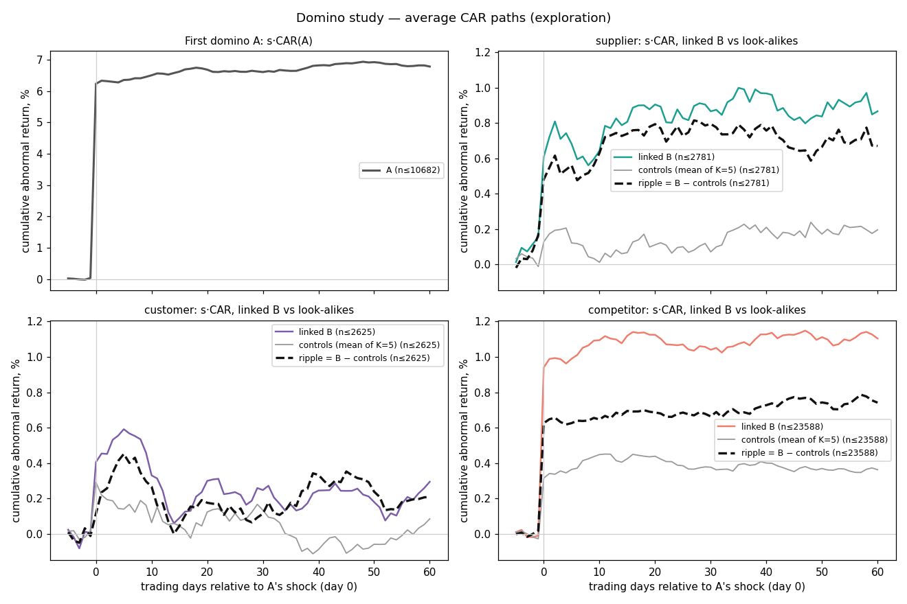

# Domino study — exploration readout (2015–2021)

Generated 2026-10-18 from code commit `fd58910` under the frozen pre-registration (`docs/superpowers/specs/2026-10-18-domino-study-design.md`, incl. its §13 log). The holdout (2022+) stays **LOCKED** until this readout is committed; the gate then checks the integrity table at the end against the research store.

Question: when one company has a large price shock of its own, do its graph-linked suppliers, customers and competitors move more than matched unlinked look-alikes, on the same day or slowly afterwards? Ripple = s·[CAR(B) − mean CAR(look-alikes)], so a positive ripple means B followed A's direction.

## Plain-language summary

- Exploration years 2015–2021: 10986 first-domino price shocks gave 30010 shock → linked-company events on 1553 days.
- Slow-ripple candidates that cleared the strict exploration bar (Holm + |t| > 3): customer [+1,+5] +0.32% (t 3.53).
- Same-day candidates: supplier, competitor.
- Power: the smallest 20-day ripple the data reliably detects is 0.75% (supplier), 0.60% (customer), 0.30% (competitor); every role passes the power rule.
- None of this is proof yet. Exploration only nominates candidates; the verdict comes from the locked 2022+ holdout.

## Verdict (provisional — exploration only)

| Role | Power: 20-day MDE | Same-day (H1) | Slow-ripple candidates (H2) | Pre-trend (H3) | Status |
|---|---|---|---|---|---|
| supplier | 0.75% | candidate | — | ok | same-day candidate → holdout |
| customer | 0.60% | — | [+1,+5] | ok | slow-ripple candidate → holdout |
| competitor | 0.30% | candidate | — | ok | same-day candidate → holdout |

## Data

- Prices: yfinance, total-return adjusted for returns; 2013-09-01 to 2026-10-17 (end exclusive); 580 symbols fetched, unavailable: CAJ, ERJ, SATS, TEF.
- Symbols with fewer than 200 price rows (delisted or taken private; never usable): AVB, EA, EQR, PSKY, WBD. Survivorship: firms that left the market are missing (§11).
- Sector ETFs that start late (robustness 1 cannot use those sectors before then plus a ~1-year estimation window): XLC from 2018-06-19, XLRE from 2015-10-08.
- Dollar volume uses a separate unadjusted-close snapshot (no dividend look-ahead): 1829819 common rows; volume mismatches 0; adjusted-above-raw rows 0; symbols without raw history 0 (their dollar volume is missing, never imputed).
- Study links (directed, 'if A shocks, B is A's role'): supplier 145, customer 145, competitor 1304; ordered pairs holding more than one role: 14.
- Events (shock at A, linked B, role): supplier 2848, customer 2704, competitor 24458; distinct event dates 1553; first-domino shocks 10986.
- Embargo: exploration windows ending after 2021-12-31 are not measured (events per window): supplier [+1,+5] 0, [+1,+20] 21, [+1,+60] 67; customer [+1,+5] 0, [+1,+20] 33, [+1,+60] 79; competitor [+1,+5] 21, [+1,+20] 229, [+1,+60] 870.

## Power check (spec §5, run before any hypothesis test)

Smallest synthetic 20-day ripple detected in 80% of date-bootstrap replicates under the full exploration rule; above 1.5% a role is underpowered / inconclusive, never 'no effect'. The 80%-upper-bound and two-way MDEs, the effective number of dates (by events / by variance) and the borderline notes are descriptive caveats, fixed before any outcome was measured.

| Role | Events | Dates | SE [+1,+20] | MDE [+1,+5] | MDE [+1,+20] | MDE [+1,+60] | MDE upper bound | MDE two-way | Effective dates | Underpowered | Borderline because |
|---|---|---|---|---|---|---|---|---|---|---|---|
| supplier | 2848 | 787 | 0.20% | 1.50% | 0.75% | 1.35% | 0.85% | 0.76% | 311 / 22 | no | — |
| customer | 2704 | 700 | 0.16% | 1.45% | 0.60% | 1.10% | 0.65% | 0.52% | 280 / 49 | no | — |
| competitor | 24458 | 1534 | 0.07% | 0.60% | 0.30% | 0.45% | 0.30% | 0.26% | 606 / 80 | no | — |

Projected holdout power ([+1,+20], calendar arithmetic only — no holdout data): the ripple the holdout leg can confirm (one-sided p < 0.05 and the 50 bp floor), the ripple the full exploration × holdout chain detects 80% of the time, and the chain's power at 1.5%.

| Role | Exploration days | Holdout days | Holdout-leg MDE | Full-chain MDE | Full-chain power at 1.5% |
|---|---|---|---|---|---|
| supplier | 1743 | 1182 | 0.70% | 0.85% | 100.00% |
| customer | 1743 | 1182 | 0.66% | 0.75% | 100.00% |
| competitor | 1743 | 1182 | 0.57% | 0.60% | 100.00% |

## H1 — same-day ripple

Pass in exploration: mean Ripple[0,0] > 0 with t > 3 (date-clustered).

| Role | Mean [0,0] | t | Exploration |
|---|---|---|---|
| supplier | +0.32% | 3.86 | candidate |
| customer | +0.13% | 1.79 | fail |
| competitor | +0.61% | 15.93 | candidate |

## H2 — slow ripple (primary family: 3 roles × 3 windows)

Pass in exploration: Holm at family α = 0.05 on two-sided date-clustered p, and |t| > 3. Passing tests go to the holdout in their exploration direction. The last column is an exploratory diagnostic (t clustered by date AND linked firm; ⚠ = a pass below |t| = 3).

| Role | Window | Mean | t (date) | p two-sided | Holm | \|t\| > 3 | Exploration | t two-way |
|---|---|---|---|---|---|---|---|---|
| supplier | [+1,+5] | +0.08% | 0.76 | 0.4458 | no | no | fail | 0.94 |
| supplier | [+1,+20] | +0.28% | 1.45 | 0.1474 | no | no | fail | 1.44 |
| supplier | [+1,+60] | +0.19% | 0.56 | 0.5767 | no | no | fail | 0.57 |
| customer | [+1,+5] | +0.32% | 3.53 | 0.0004 | yes | yes | **PASS** | 3.61 |
| customer | [+1,+20] | +0.08% | 0.49 | 0.6260 | no | no | fail | 0.56 |
| customer | [+1,+60] | +0.09% | 0.35 | 0.7256 | no | no | fail | 0.37 |
| competitor | [+1,+5] | -0.00% | -0.11 | 0.9096 | no | no | fail | -0.11 |
| competitor | [+1,+20] | +0.06% | 0.95 | 0.3418 | no | no | fail | 0.95 |
| competitor | [+1,+60] | +0.12% | 0.98 | 0.3284 | no | no | fail | 0.97 |

## H3 — pre-trend

Ripple[-5,-1] must have |t| < 2 for any role that passes H1 or H2; otherwise the role is flagged as possible shared information rather than transmission. 'Could not be tested' is never read as ok.

| Role | Mean [-5,-1] | t | Status | Required |
|---|---|---|---|---|
| supplier | +0.19% | 1.91 | ok | yes |
| customer | +0.00% | 0.00 | ok | yes |
| competitor | +0.03% | 0.93 | ok | yes |

## H4 — direction by role (descriptive)

Every role × window, equal-weighted across events. t (date) is the primary clustering; t (week) and the date-block bootstrap 95% CI are robustness; t two-way is an exploratory diagnostic.

| Role | Window | Mean | t (date) | t (week) | 95% CI (bootstrap) | t two-way | Events | Dates |
|---|---|---|---|---|---|---|---|---|
| supplier | [-5,-1] | +0.19% | 1.91 | 1.89 | -0.01% to +0.39% | 1.96 | 2848 | 787 |
| supplier | [0,0] | +0.32% | 3.86 | 3.73 | +0.18% to +0.49% | 2.83 | 2848 | 787 |
| supplier | [+1,+5] | +0.08% | 0.76 | 0.72 | -0.11% to +0.26% | 0.94 | 2848 | 787 |
| supplier | [+1,+20] | +0.28% | 1.45 | 1.46 | -0.10% to +0.67% | 1.44 | 2827 | 779 |
| supplier | [+1,+60] | +0.19% | 0.56 | 0.58 | -0.50% to +0.86% | 0.57 | 2781 | 763 |
| customer | [-5,-1] | +0.00% | 0.00 | 0.00 | -0.18% to +0.17% | 0.00 | 2704 | 700 |
| customer | [0,0] | +0.13% | 1.79 | 1.80 | -0.01% to +0.27% | 1.66 | 2704 | 700 |
| customer | [+1,+5] | +0.32% | 3.53 | 3.36 | +0.14% to +0.50% | 3.61 | 2704 | 700 |
| customer | [+1,+20] | +0.08% | 0.49 | 0.49 | -0.23% to +0.39% | 0.56 | 2671 | 691 |
| customer | [+1,+60] | +0.09% | 0.35 | 0.34 | -0.44% to +0.64% | 0.37 | 2625 | 675 |
| competitor | [-5,-1] | +0.03% | 0.93 | 1.02 | -0.03% to +0.10% | 0.93 | 24458 | 1534 |
| competitor | [0,0] | +0.61% | 15.93 | 16.45 | +0.55% to +0.69% | 10.37 | 24458 | 1534 |
| competitor | [+1,+5] | -0.00% | -0.11 | -0.12 | -0.07% to +0.06% | -0.11 | 24437 | 1530 |
| competitor | [+1,+20] | +0.06% | 0.95 | 0.86 | -0.07% to +0.20% | 0.95 | 24229 | 1517 |
| competitor | [+1,+60] | +0.12% | 0.98 | 0.91 | -0.12% to +0.35% | 0.97 | 23588 | 1480 |

## H5 — first-domino drift (descriptive)

s·CAR(A) after the shock day: positive = continuation, negative = reversal.

| Window | Mean s·CAR(A) | t (date) | Shocks |
|---|---|---|---|
| [+1,+5] | +0.12% | 1.31 | 10978 |
| [+1,+20] | +0.44% | 2.74 | 10916 |
| [+1,+60] | +0.55% | 2.17 | 10682 |

## H6 — what makes ripples bigger (hypothesis-generating, exploration only)

A pattern here can only be claimed if it is registered in spec §13 before the holdout opens and then confirmed in the holdout. terciles of B's [-80,-21] dollar volume within each event year with >= 30 events; events in thinner years: 0.

### shock_sign

| Group | Role | [+1,+5] | [+1,+20] | [+1,+60] | Events |
|---|---|---|---|---|---|
| up | supplier | +0.10% (t 0.67) | +0.35% (t 1.15) | +0.43% (t 0.83) | 1373 |
| up | customer | +0.50% (t 3.38) | +0.29% (t 1.22) | +0.51% (t 1.48) | 1264 |
| up | competitor | -0.03% (t -0.61) | +0.17% (t 1.81) | +0.43% (t 2.66) | 12243 |
| down | supplier | +0.05% (t 0.39) | +0.22% (t 0.93) | -0.04% (t -0.09) | 1454 |
| down | customer | +0.16% (t 1.26) | -0.12% (t -0.51) | -0.28% (t -0.67) | 1407 |
| down | competitor | +0.02% (t 0.37) | -0.04% (t -0.38) | -0.20% (t -1.22) | 11986 |

### shock_size

| Group | Role | [+1,+5] | [+1,+20] | [+1,+60] | Events |
|---|---|---|---|---|---|
| 3to4_sigma | supplier | -0.05% (t -0.42) | -0.11% (t -0.49) | -0.03% (t -0.07) | 1554 |
| 3to4_sigma | customer | +0.39% (t 3.11) | -0.04% (t -0.19) | -0.19% (t -0.51) | 1467 |
| 3to4_sigma | competitor | -0.07% (t -1.53) | -0.04% (t -0.39) | +0.08% (t 0.53) | 12803 |
| ge4_sigma | supplier | +0.23% (t 1.66) | +0.77% (t 2.60) | +0.46% (t 0.96) | 1273 |
| ge4_sigma | customer | +0.24% (t 1.85) | +0.21% (t 0.96) | +0.43% (t 1.29) | 1204 |
| ge4_sigma | competitor | +0.07% (t 1.41) | +0.18% (t 1.91) | +0.15% (t 0.91) | 11426 |

### abnormal_volume

| Group | Role | [+1,+5] | [+1,+20] | [+1,+60] | Events |
|---|---|---|---|---|---|
| gt2x | supplier | +0.17% (t 1.40) | +0.45% (t 1.77) | +0.23% (t 0.52) | 1857 |
| gt2x | customer | +0.24% (t 2.27) | -0.01% (t -0.04) | -0.03% (t -0.08) | 1663 |
| gt2x | competitor | -0.00% (t -0.11) | +0.09% (t 1.06) | +0.02% (t 0.12) | 15443 |
| le2x | supplier | -0.11% (t -0.72) | -0.03% (t -0.11) | +0.10% (t 0.21) | 970 |
| le2x | customer | +0.46% (t 3.04) | +0.21% (t 0.89) | +0.29% (t 0.70) | 1008 |
| le2x | competitor | -0.00% (t -0.05) | +0.02% (t 0.15) | +0.29% (t 1.49) | 8786 |

### link_weight

| Group | Role | [+1,+5] | [+1,+20] | [+1,+60] | Events |
|---|---|---|---|---|---|
| weighted | supplier | +0.27% (t 1.49) | +0.55% (t 1.56) | +0.16% (t 0.26) | 751 |
| weighted | customer | -0.01% (t -0.07) | -0.25% (t -0.90) | -0.07% (t -0.15) | 755 |
| weighted | competitor | n/a (t n/a) | n/a (t n/a) | n/a (t n/a) | 0 |
| unweighted | supplier | +0.00% (t 0.03) | +0.19% (t 0.91) | +0.20% (t 0.57) | 2076 |
| unweighted | customer | +0.45% (t 3.94) | +0.20% (t 1.15) | +0.16% (t 0.50) | 1916 |
| unweighted | competitor | -0.00% (t -0.11) | +0.06% (t 0.95) | +0.12% (t 0.98) | 24229 |
| weight_tercile_1 | supplier | +0.51% (t 1.53) | +0.95% (t 1.36) | +1.40% (t 1.29) | 240 |
| weight_tercile_1 | customer | +0.21% (t 0.72) | -0.38% (t -0.68) | +0.47% (t 0.55) | 245 |
| weight_tercile_1 | competitor | n/a (t n/a) | n/a (t n/a) | n/a (t n/a) | 0 |
| weight_tercile_2 | supplier | -0.01% (t -0.04) | +0.62% (t 1.65) | +0.34% (t 0.39) | 259 |
| weight_tercile_2 | customer | -0.17% (t -0.92) | +0.28% (t 0.78) | +0.82% (t 1.23) | 276 |
| weight_tercile_2 | competitor | n/a (t n/a) | n/a (t n/a) | n/a (t n/a) | 0 |
| weight_tercile_3 | supplier | +0.34% (t 1.16) | +0.10% (t 0.17) | -1.24% (t -1.32) | 252 |
| weight_tercile_3 | customer | -0.04% (t -0.17) | -0.75% (t -1.38) | -1.66% (t -1.95) | 234 |
| weight_tercile_3 | competitor | n/a (t n/a) | n/a (t n/a) | n/a (t n/a) | 0 |

### b_size

| Group | Role | [+1,+5] | [+1,+20] | [+1,+60] | Events |
|---|---|---|---|---|---|
| dv_tercile_1_within_year | supplier | -0.06% (t -0.34) | +0.41% (t 1.17) | +0.19% (t 0.31) | 977 |
| dv_tercile_1_within_year | customer | +0.25% (t 0.81) | -0.27% (t -0.69) | +0.21% (t 0.33) | 374 |
| dv_tercile_1_within_year | competitor | +0.00% (t 0.02) | +0.06% (t 0.52) | +0.10% (t 0.54) | 8556 |
| dv_tercile_2_within_year | supplier | +0.07% (t 0.60) | +0.10% (t 0.40) | -0.16% (t -0.40) | 1338 |
| dv_tercile_2_within_year | customer | +0.38% (t 2.26) | -0.15% (t -0.56) | -0.13% (t -0.28) | 774 |
| dv_tercile_2_within_year | competitor | +0.10% (t 1.80) | +0.26% (t 2.59) | +0.51% (t 2.86) | 7801 |
| dv_tercile_3_within_year | supplier | +0.33% (t 1.82) | +0.54% (t 1.37) | +1.07% (t 1.57) | 512 |
| dv_tercile_3_within_year | customer | +0.31% (t 3.12) | +0.28% (t 1.35) | +0.18% (t 0.50) | 1523 |
| dv_tercile_3_within_year | competitor | -0.11% (t -1.90) | -0.12% (t -0.98) | -0.25% (t -1.29) | 7872 |

## Transmission coefficient γ

OLS of [CAR(B) − mean CAR(look-alikes)] on AR(A, 0), clustered by date: the share of A's shock that shows up in B beyond what look-alikes show.

| Role | Window | γ | t | Events |
|---|---|---|---|---|
| supplier | [0,0] | 0.0574 | 3.65 | 2848 |
| supplier | [+1,+5] | 0.0128 | 0.89 | 2848 |
| supplier | [+1,+20] | 0.0568 | 1.86 | 2827 |
| supplier | [+1,+60] | 0.0391 | 0.79 | 2781 |
| customer | [0,0] | 0.0178 | 1.91 | 2704 |
| customer | [+1,+5] | 0.0354 | 2.85 | 2704 |
| customer | [+1,+20] | -0.0040 | -0.19 | 2671 |
| customer | [+1,+60] | 0.0095 | 0.29 | 2625 |
| competitor | [0,0] | 0.0828 | 9.51 | 24458 |
| competitor | [+1,+5] | 0.0017 | 0.33 | 24437 |
| competitor | [+1,+20] | 0.0173 | 1.64 | 24229 |
| competitor | [+1,+60] | 0.0255 | 1.42 | 23588 |

## Robustness (spec §8 — reported, never changes the verdict)

### R1–R3: model and shock-rule variants (H2 family re-run; ✓ = passes the exploration rule in that variant)

| Check | Role | [+1,+5] | [+1,+20] | [+1,+60] |
|---|---|---|---|---|
| R1 sector-ETF excess return | supplier | +0.17% (t 1.45) | +0.31% (t 1.42) | +0.17% (t 0.47) |
| R1 sector-ETF excess return | customer | +0.12% (t 1.33) | +0.11% (t 0.63) | +0.36% (t 1.23) |
| R1 sector-ETF excess return | competitor | +0.02% (t 0.66) | +0.09% (t 1.22) | +0.12% (t 1.13) |
| R2 Fama-French 5 factors + momentum | supplier | +0.14% (t 1.46) | +0.28% (t 1.58) | +0.17% (t 0.54) |
| R2 Fama-French 5 factors + momentum | customer | +0.22% (t 2.58) | +0.18% (t 1.12) | +0.23% (t 0.85) |
| R2 Fama-French 5 factors + momentum | competitor | +0.02% (t 0.54) | +0.13% (t 1.99) | +0.05% (t 0.46) |
| R3a 4σ shocks | supplier | +0.13% (t 0.92) | +0.67% (t 2.38) | +0.31% (t 0.72) |
| R3a 4σ shocks | customer | +0.27% (t 2.29) | +0.11% (t 0.54) | +0.24% (t 0.71) |
| R3a 4σ shocks | competitor | +0.06% (t 0.93) | +0.19% (t 1.92) | +0.18% (t 1.07) |
| R3b top 1% \|AR\| per firm | supplier | +0.05% (t 0.37) | +0.43% (t 1.44) | -0.19% (t -0.41) |
| R3b top 1% \|AR\| per firm | customer | +0.12% (t 0.98) | -0.21% (t -0.91) | -0.13% (t -0.35) |
| R3b top 1% \|AR\| per firm | competitor | +0.02% (t 0.32) | +0.09% (t 0.91) | +0.15% (t 0.87) |

### R4, R5, R7, R8: subsets and K

R8 counts a link carrying both LLM and manual provenance in both subsets (0 events).

| Check | Role | [+1,+5] | [+1,+20] | [+1,+60] | Events [+1,+20] |
|---|---|---|---|---|---|
| R4 excluding 2020-02-15 to 2020-06-30 (COVID crash) | supplier | +0.01% (t 0.06) | +0.16% (t 0.92) | +0.00% (t 0.00) | 2594 |
| R4 excluding 2020-02-15 to 2020-06-30 (COVID crash) | customer | +0.28% (t 3.38) | +0.12% (t 0.73) | +0.10% (t 0.37) | 2424 |
| R4 excluding 2020-02-15 to 2020-06-30 (COVID crash) | competitor | +0.00% (t 0.12) | +0.03% (t 0.45) | +0.06% (t 0.46) | 22066 |
| R5 excluding industry-wide shocks (\|sector ETF z\| ≥ 2) | supplier | +0.10% (t 0.89) | +0.14% (t 0.74) | +0.11% (t 0.27) | 1868 |
| R5 excluding industry-wide shocks (\|sector ETF z\| ≥ 2) | customer | +0.25% (t 2.72) | -0.10% (t -0.58) | -0.25% (t -0.84) | 1959 |
| R5 excluding industry-wide shocks (\|sector ETF z\| ≥ 2) | competitor | +0.02% (t 0.52) | +0.06% (t 0.80) | +0.08% (t 0.65) | 18748 |
| R7 K = 3 controls | supplier | +0.09% (t 0.89) | +0.31% (t 1.54) | +0.27% (t 0.77) | 2827 |
| R7 K = 3 controls | customer | +0.26% (t 2.91) | +0.00% (t 0.00) | -0.01% (t -0.03) | 2671 |
| R7 K = 3 controls | competitor | -0.02% (t -0.55) | +0.02% (t 0.33) | +0.03% (t 0.29) | 24229 |
| R7 K = 10 controls | supplier | +0.07% (t 0.67) | +0.28% (t 1.44) | +0.26% (t 0.77) | 2827 |
| R7 K = 10 controls | customer | +0.28% (t 3.11) | +0.08% (t 0.47) | +0.15% (t 0.55) | 2671 |
| R7 K = 10 controls | competitor | -0.01% (t -0.40) | +0.05% (t 0.85) | +0.10% (t 0.88) | 24229 |
| R8 LLM-extracted links only | supplier | +0.08% (t 0.76) | +0.28% (t 1.45) | +0.19% (t 0.56) | 2827 |
| R8 LLM-extracted links only | customer | +0.32% (t 3.53) | +0.08% (t 0.49) | +0.09% (t 0.35) | 2671 |
| R8 LLM-extracted links only | competitor | -0.00% (t -0.05) | +0.06% (t 0.88) | +0.10% (t 0.83) | 23959 |
| R8 manual links only | supplier | n/a (t n/a) | n/a (t n/a) | n/a (t n/a) | 0 |
| R8 manual links only | customer | n/a (t n/a) | n/a (t n/a) | n/a (t n/a) | 0 |
| R8 manual links only | competitor | -0.21% (t -0.84) | +0.43% (t 0.86) | +1.76% (t 1.49) | 270 |

### R9: raw linked and control moves on the ripple's own sample (how much is industry-wide)

| Role | Window | Linked B s·CAR | Look-alikes s·CAR | Ripple |
|---|---|---|---|---|
| supplier | [0,0] | +0.46% (t 5.27) | +0.14% (t 4.00) | +0.32% (t 3.86) |
| supplier | [+1,+5] | +0.06% (t 0.65) | -0.02% (t -0.21) | +0.08% (t 0.76) |
| supplier | [+1,+20] | +0.25% (t 1.39) | -0.04% (t -0.32) | +0.28% (t 1.45) |
| supplier | [+1,+60] | +0.26% (t 0.76) | +0.07% (t 0.34) | +0.19% (t 0.56) |
| customer | [0,0] | +0.40% (t 5.10) | +0.28% (t 5.73) | +0.13% (t 1.79) |
| customer | [+1,+5] | +0.18% (t 1.80) | -0.14% (t -1.79) | +0.32% (t 3.53) |
| customer | [+1,+20] | -0.10% (t -0.52) | -0.17% (t -1.09) | +0.08% (t 0.49) |
| customer | [+1,+60] | -0.11% (t -0.37) | -0.21% (t -0.81) | +0.09% (t 0.35) |
| competitor | [0,0] | +0.95% (t 15.71) | +0.34% (t 10.35) | +0.61% (t 15.93) |
| competitor | [+1,+5] | +0.05% (t 1.04) | +0.06% (t 1.63) | -0.00% (t -0.11) |
| competitor | [+1,+20] | +0.19% (t 2.14) | +0.12% (t 1.95) | +0.06% (t 0.95) |
| competitor | [+1,+60] | +0.16% (t 1.12) | +0.05% (t 0.47) | +0.12% (t 0.98) |

### R10 (exploratory, not pre-registered): without events where B had its own shock in [e−10, e]

Share of events affected: supplier 20.29%, customer 20.19%, competitor 22.86%.

| Role | [+1,+5] | [+1,+20] | [+1,+60] | Events [+1,+20] |
|---|---|---|---|---|
| supplier | -0.01% (t -0.08) | +0.16% (t 0.79) | +0.00% (t 0.01) | 2250 |
| customer | +0.28% (t 2.72) | -0.04% (t -0.25) | -0.00% (t -0.01) | 2128 |
| competitor | +0.02% (t 0.47) | +0.10% (t 1.38) | +0.06% (t 0.51) | 18679 |

## Figures

Average cumulative abnormal return paths, day −5 to +60, on events with a complete 60-day ripple (exploration).

## Integrity

sha256 of the exploration results and power files this readout was written from. The holdout gate compares these against the research store before any holdout event is built.

| File | sha256 |
|---|---|
| `power.json` | 242bfe9f70a677cc52f7a501b5c9163966628c9b8430136942b30f75f8060334 |
| `power__ff6_sigma3.json` | da6ad8c56335a20f8eca5c2c27f8153ba73785e35b91af13488515ffe88e55bf |
| `power__market_sigma4.json` | e332b78527eb3bc018b44b52fefab06593517f040ad665939377f45e7ff4e6f2 |
| `power__market_top1pct.json` | fb3c250bcfef2515fb8483bd0c88b5f49dcf62a67f693f61707d4041465ad625 |
| `power__sector_etf_sigma3.json` | f47900bca02166b884b6de632c385076aa274ab76c08b49c1f87b11b1ce0b6f1 |
| `results_exploration.json` | c12cb8bcb937cf4be4175d7ba6eaa93a5b7821e1eae48271619e4b63c3d11c5c |
| `results_exploration__ff6_sigma3.json` | ceb0a8a5856bef5f6536a428fb1491e72bda6ed2ddcf74204dabbc20495e99cd |
| `results_exploration__market_sigma4.json` | a1b1f1b88f400eb26ebb11a7ae566c9490e78455f4a5219223dbe9910b7d8944 |
| `results_exploration__market_top1pct.json` | 4dd1bef0ca4396a2c65ee5ae17f24931929924a01a10959934bc7aaff88b2572 |
| `results_exploration__sector_etf_sigma3.json` | f0a349ecc5422150db80c91a93f6581bd4646ef029dbf9da2a48d82761163140 |
