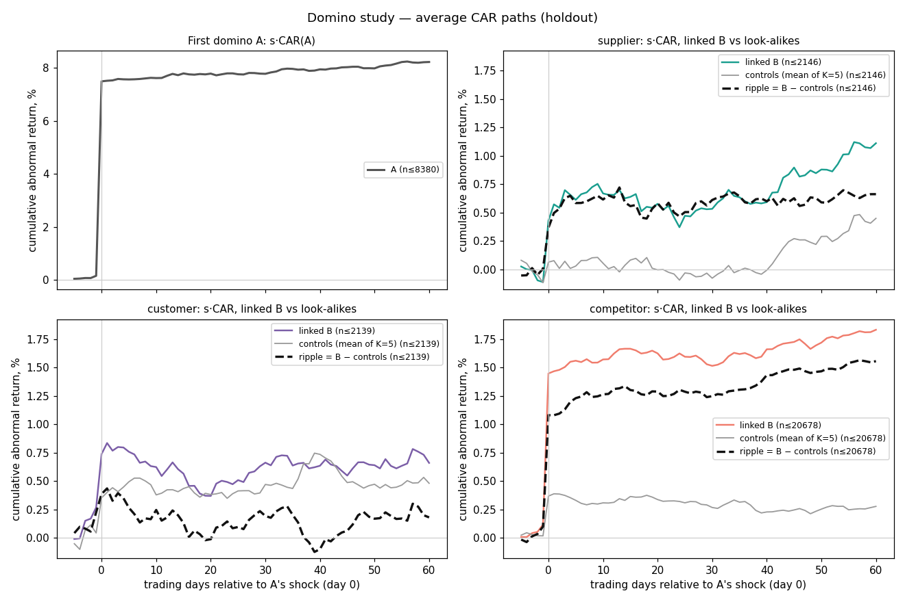

# Domino study — holdout readout (2022+)

Generated 2026-10-18 from code commit `6bc906f`. The exploration readout (`readout-exploration.md`) was committed before any holdout event was built, and the gate verified its integrity table against the research store.

## Plain-language summary

- **Same-day ripple only.** supplier, competitor: the market prices the link on the same day; any value sits in a latency race, so Stage 2 is not justified for trading. customer: no ripple: close the price-ripple thesis for these link types.
- customer [+1,+5]: not confirmed (did not replicate; below the 0.5% floor; did not beat the placebo); holdout mean -0.08% in the exploration direction.
- Same-day supplier: confirmed (holdout mean +0.34%).
- Same-day competitor: confirmed (holdout mean +1.00%).
- What 'same day' does and does not show: a same-day ripple cannot separate A→B transmission from shared same-day news or finer sub-industry co-movement, because look-alikes are matched only on GICS sector. It is measured close to close, so it says nothing about speed within the day.
- Descriptively, competitor [+1,+5] moved +0.17% (t 3.03) in the holdout, but it was not nominated by exploration and is below the 0.5% floor, so it cannot be claimed — it is a lead for a new pre-registered test on fresh data.
- Descriptively, competitor [+1,+20] moved +0.25% (t 2.38) in the holdout, but it was not nominated by exploration and is below the 0.5% floor, so it cannot be claimed — it is a lead for a new pre-registered test on fresh data.
- Descriptively, competitor [+1,+60] moved +0.48% (t 2.28) in the holdout, but it was not nominated by exploration and is below the 0.5% floor, so it cannot be claimed — it is a lead for a new pre-registered test on fresh data.
- Research only: close-to-close returns, no trading costs beyond the 50 bp floor, no news latency.

## Verdict (spec §7)

**Overall: Same-day ripple only.** supplier, competitor: the market prices the link on the same day; any value sits in a latency race, so Stage 2 is not justified for trading. customer: no ripple: close the price-ripple thesis for these link types.

| Role | Verdict | Power: 20-day MDE | Full-chain power at 1.5% (projected) | Pre-trend |
|---|---|---|---|---|
| supplier | same-day only | 0.75% | 100.00% | ok |
| customer | no ripple | 0.60% | 100.00% | ok |
| competitor | same-day only | 0.30% | 100.00% | ok |

## Data

- Prices: yfinance, total-return adjusted for returns; 2013-09-01 to 2026-10-17 (end exclusive); 580 symbols fetched, unavailable: CAJ, ERJ, SATS, TEF.
- Symbols with fewer than 200 price rows in the Yahoo snapshot (never usable; likely delisted, taken private or re-tickered — the cause was not verified): AVB, EA, EQR, PSKY, WBD. Survivorship: firms missing from the snapshot are missing here (§11).
- Sector ETFs that start late (robustness 1 cannot use those sectors before then plus a ~1-year estimation window): XLC from 2018-06-19, XLRE from 2015-10-08.
- Dollar volume uses a separate unadjusted-close snapshot (no dividend look-ahead): 1829819 common rows; volume mismatches 0; adjusted-above-raw rows 0; symbols without raw history 0 (their dollar volume is missing, never imputed).
- Study links (directed, 'if A shocks, B is A's role'): supplier 145, customer 145, competitor 1304; ordered pairs holding more than one role: 14.
- Events (shock at A, linked B, role): supplier 2249, customer 2242, competitor 21425; distinct event dates 1069; first-domino shocks 8693.

## H2 — slow ripple, holdout chain

A test passes only if all hold: it passed exploration; the holdout has the same sign with one-sided p < 0.05; the holdout mean is at least 0.5% in that direction; and it beats the 95th percentile of the placebo (each linked firm relabelled to one random same-sector firm that is not linked to the shocked firm). Candidates' means and t are shown in the exploration direction; rows that were not exploration candidates were not tested and show the raw holdout move only. The last column is the exploratory two-way (date × linked firm) one-sided p (⚠ = a pass it does not confirm).

| Role | Window | Exploration pass | Direction | Holdout mean (in direction) | t (in direction) | p one-sided | Replicates | ≥ 0.5% | Placebo 95th pct (in direction) | Beats placebo | Result | p two-way |
|---|---|---|---|---|---|---|---|---|---|---|---|---|
| supplier | [+1,+5] | no | — | +0.17% (raw) | 1.46 (raw) | — | — | — | not run | — | not a candidate | — |
| supplier | [+1,+20] | no | — | +0.16% (raw) | 0.65 (raw) | — | — | — | not run | — | not a candidate | — |
| supplier | [+1,+60] | no | — | +0.30% (raw) | 0.79 (raw) | — | — | — | not run | — | not a candidate | — |
| customer | [+1,+5] | yes | + | -0.08% | -0.59 | 0.7235 | no | no | +0.20% (n 500/500) | no | fail | 0.7250 |
| customer | [+1,+20] | no | — | -0.33% (raw) | -1.47 (raw) | — | — | — | not run | — | not a candidate | — |
| customer | [+1,+60] | no | — | -0.21% (raw) | -0.50 (raw) | — | — | — | not run | — | not a candidate | — |
| competitor | [+1,+5] | no | — | +0.17% (raw) | 3.03 (raw) | — | — | — | not run | — | not a candidate | — |
| competitor | [+1,+20] | no | — | +0.25% (raw) | 2.38 (raw) | — | — | — | not run | — | not a candidate | — |
| competitor | [+1,+60] | no | — | +0.48% (raw) | 2.28 (raw) | — | — | — | not run | — | not a candidate | — |

Placebo diagnostics (evaluable only with ≥ 90% finite permutations and median coverage ≥ 50% of the real events; SD ratio = placebo SD / real date-clustered SE, ⚠ below 0.8):

| Test | Finite | Coverage | Pool size | Links dropped | p50 | p95 | SD ratio | Evaluable |
|---|---|---|---|---|---|---|---|---|
| customer w5 | 500 | 2017 / 2241 | 57 (min 22) | 9.53% | -0.01% | +0.20% | 0.93 | ok |

## H1 — same-day ripple, holdout

The last two columns are the exploratory two-way (date × linked firm) diagnostics: the exploration t (⚠ = a candidate below |t| = 3) and the holdout one-sided p (⚠ = a pass it does not confirm).

| Role | Exploration | Holdout mean [0,0] | t | p one-sided | Result | Exploration t two-way | Holdout p two-way |
|---|---|---|---|---|---|---|---|
| supplier | candidate | +0.34% | 4.01 | <0.0001 | **PASS** | 2.83 ⚠ | 0.0018 |
| customer | fail | +0.13% | 1.43 | 0.0761 | fail | 1.66 | 0.1494 |
| competitor | candidate | +1.00% | 21.52 | <0.0001 | **PASS** | 10.37 | <0.0001 |

## H3 — pre-trend in both periods

| Role | t exploration | t holdout | Status | Required |
|---|---|---|---|---|
| supplier | 1.91 | -0.18 | ok | yes |
| customer | 0.00 | 1.34 | ok | yes |
| competitor | 0.93 | 1.90 | ok | yes |

## H4 — direction by role, holdout (descriptive)

| Role | Window | Mean | t (date) | t (week) | 95% CI (bootstrap) | t two-way | Events | Dates |
|---|---|---|---|---|---|---|---|---|
| supplier | [-5,-1] | -0.02% | -0.18 | -0.19 | -0.30% to +0.24% | -0.21 | 2249 | 587 |
| supplier | [0,0] | +0.34% | 4.01 | 4.26 | +0.17% to +0.49% | 3.02 | 2249 | 587 |
| supplier | [+1,+5] | +0.17% | 1.46 | 1.38 | -0.06% to +0.41% | 1.40 | 2246 | 585 |
| supplier | [+1,+20] | +0.16% | 0.65 | 0.62 | -0.34% to +0.63% | 0.68 | 2231 | 580 |
| supplier | [+1,+60] | +0.30% | 0.79 | 0.77 | -0.42% to +1.03% | 0.70 | 2146 | 557 |
| customer | [-5,-1] | +0.18% | 1.34 | 1.34 | -0.07% to +0.44% | 1.68 | 2242 | 550 |
| customer | [0,0] | +0.13% | 1.43 | 1.53 | -0.04% to +0.30% | 1.05 | 2242 | 550 |
| customer | [+1,+5] | -0.08% | -0.59 | -0.55 | -0.35% to +0.18% | -0.60 | 2241 | 549 |
| customer | [+1,+20] | -0.33% | -1.47 | -1.51 | -0.77% to +0.11% | -1.46 | 2228 | 546 |
| customer | [+1,+60] | -0.21% | -0.50 | -0.49 | -0.99% to +0.58% | -0.49 | 2139 | 527 |
| competitor | [-5,-1] | +0.09% | 1.90 | 1.96 | -0.00% to +0.19% | 1.83 | 21425 | 1056 |
| competitor | [0,0] | +1.00% | 21.52 | 18.69 | +0.91% to +1.09% | 13.85 | 21425 | 1056 |
| competitor | [+1,+5] | +0.17% | 3.03 | 2.82 | +0.06% to +0.28% | 2.85 | 21407 | 1053 |
| competitor | [+1,+20] | +0.25% | 2.38 | 2.36 | +0.04% to +0.46% | 2.28 | 21323 | 1042 |
| competitor | [+1,+60] | +0.48% | 2.28 | 2.45 | +0.06% to +0.90% | 2.19 | 20678 | 1005 |

## H5 — first-domino drift, holdout (descriptive)

| Window | Mean s·CAR(A) | t (date) | Shocks |
|---|---|---|---|
| [+1,+5] | +0.06% | 0.69 | 8678 |
| [+1,+20] | +0.32% | 2.26 | 8637 |
| [+1,+60] | +0.73% | 2.82 | 8380 |

## H6 — registered follow-ups (spec §13; registered before the holdout opened, never verdict inputs)

| Id | Hypothesis | Holdout mean | t | p one-sided | Events | Rest of the role | Result |
|---|---|---|---|---|---|---|---|
| H6-F1 | Among shocks with \|z\| >= 4, the supplier [+1,+20] ripple is positive (one-sided p < 0.05) | +0.06% | 0.18 | 0.4298 | 1077 | +0.25% (t 0.84) | not confirmed |

## Robustness (spec §8 — reported, never changes the verdict)

### R6: holdout restricted to 2024 onward

| Role | [+1,+5] | [+1,+20] | [+1,+60] | Events [+1,+20] |
|---|---|---|---|---|
| supplier | +0.01% (t 0.08) | -0.07% (t -0.22) | -0.21% (t -0.41) | 1381 |
| customer | -0.16% (t -0.92) | -0.42% (t -1.44) | -0.71% (t -1.34) | 1362 |
| competitor | +0.18% (t 2.44) | +0.26% (t 1.81) | +0.64% (t 2.05) | 13066 |

### R1–R3: model and shock-rule variants in the holdout (✓ = the variant passed its own exploration rule, replicates one-sided p < 0.05 and clears the 50 bp floor; no placebo)

| Check | Role | [+1,+5] | [+1,+20] | [+1,+60] |
|---|---|---|---|---|
| R1 sector-ETF excess return | supplier | +0.18% in dir. (p 0.0600) | +0.39% in dir. (p 0.0349) | +0.36% in dir. (p 0.1401) |
| R1 sector-ETF excess return | customer | +0.01% in dir. (p 0.4700) | -0.16% in dir. (p 0.7590) | -0.17% in dir. (p 0.6613) |
| R1 sector-ETF excess return | competitor | +0.08% in dir. (p 0.0775) | +0.07% in dir. (p 0.2472) | +0.12% in dir. (p 0.2632) |
| R2 Fama-French 5 factors + momentum | supplier | +0.15% in dir. (p 0.1039) | +0.34% in dir. (p 0.0603) | +0.32% in dir. (p 0.1753) |
| R2 Fama-French 5 factors + momentum | customer | -0.05% in dir. (p 0.6537) | -0.25% in dir. (p 0.8886) | -0.38% in dir. (p 0.8178) |
| R2 Fama-French 5 factors + momentum | competitor | +0.10% in dir. (p 0.0247) | +0.14% in dir. (p 0.0647) | +0.37% in dir. (p 0.0166) |
| R3a 4σ shocks | supplier | +0.19% in dir. (p 0.1239) | +0.05% in dir. (p 0.4346) | -0.22% in dir. (p 0.6755) |
| R3a 4σ shocks | customer | +0.05% in dir. (p 0.3994) | -0.23% in dir. (p 0.7722) | +0.06% in dir. (p 0.4586) |
| R3a 4σ shocks | competitor | +0.22% in dir. (p 0.0005) | +0.28% in dir. (p 0.0099) | +0.38% in dir. (p 0.0528) |
| R3b top 1% \|AR\| per firm | supplier | +0.16% in dir. (p 0.1481) | +0.14% in dir. (p 0.3260) | -0.14% in dir. (p 0.6201) |
| R3b top 1% \|AR\| per firm | customer | -0.10% in dir. (p 0.7280) | +0.42% in dir. (p 0.0561) | +0.48% in dir. (p 0.1552) |
| R3b top 1% \|AR\| per firm | competitor | +0.16% in dir. (p 0.0097) | +0.26% in dir. (p 0.0270) | +0.43% in dir. (p 0.0480) |

### R10 (exploratory): without events where B had its own shock in [e−10, e]

Share of events affected: supplier 22.10%, customer 24.26%, competitor 25.37%.

| Role | [+1,+5] | [+1,+20] | [+1,+60] | Events [+1,+20] |
|---|---|---|---|---|
| supplier | +0.19% (t 1.51) | +0.15% (t 0.65) | +0.28% (t 0.70) | 1744 |
| customer | -0.05% (t -0.31) | -0.34% (t -1.30) | -0.18% (t -0.39) | 1693 |
| competitor | +0.10% (t 1.94) | +0.20% (t 1.96) | +0.19% (t 1.00) | 15906 |

## Figures

Average cumulative abnormal return paths, day −5 to +60, on events with a complete 60-day ripple (holdout).

